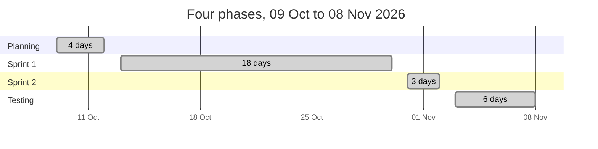

<div align="center">

# Smart Parking Management System

**Reserve a slot before you arrive · scan a QR at the gate · pay on the way out**

A full parking operation in one application: live availability for drivers, a gate console for
attendants, and occupancy and revenue reporting for the operator.

[](https://github.com/GitGud-User/SE_Mini_Project_06/actions/workflows/ci.yml)


[Quick start](#quick-start) · [Features](#what-it-does) · [Timeline](#project-timeline) ·
[Testing](#testing) · [Documents](#documents) · [Team](#team)

</div>

---

## What it does

| Role | What they can do |
| :--- | :--- |
| **Driver** | See free slots updating live · register vehicles · reserve a slot ahead with an advance payment and a QR code · change or cancel a booking with an automatic refund · view history and download receipts |
| **Gate attendant** | Log entry as a walk-in or by scanning a reservation QR · log exit with the fee calculated automatically · take cash or online payment · move a vehicle to another slot, recorded in the audit log |
| **Admin** | Manage lots, levels, slots and tariffs · put slots under maintenance · waive a fee with a reason · dashboard of occupancy, revenue, average stay and peak hours · CSV export · read the audit log · take database backups |

**Demo videos:** [Sprint 1 (1 min)](videos/sprint1_demo.mp4) · [Sprint 2 (2 min)](videos/sprint2_demo.mp4)

---

## Quick start

```bash
git clone https://github.com/GitGud-User/SE_Mini_Project_06.git
cd SE_Mini_Project_06

py -m venv .venv                      # macOS / Linux: python3 -m venv .venv
.venv\Scripts\activate                # macOS / Linux: source .venv/bin/activate

pip install -r requirements.txt
python -m backend.seed                # demo lot: 34 slots over 2 levels, plus demo accounts
uvicorn backend.main:app --reload
```

Then open **http://127.0.0.1:8000** for the app, or **http://127.0.0.1:8000/docs** for the
interactive API reference.

| Demo account | Email | Password |
| :--- | :--- | :--- |
| Admin | `admin@spms.local` | `admin123` |
| Gate attendant | `attendant@spms.local` | `attend123` |
| Driver | register one on the login page | — |

<details>
<summary><b>Optional settings</b></summary>

| Variable | Default | Purpose |
| :--- | :--- | :--- |
| `SPMS_DATABASE_URL` | `sqlite:///./spms.db` | Database. PostgreSQL-ready through SQLAlchemy, tested on SQLite |
| `SPMS_SECRET_KEY` | a development key | JWT signing key — set this in any real deployment |
| `SPMS_SMTP_HOST` and friends | unset | Send notification emails for real; otherwise they go to an outbox table |
| `SPMS_BACKUP_DIR` | `backups` | Where database backups are written |
| `SPMS_SWEEP_SECONDS` | `60` | How often no-shows are released and reminders sent |

</details>

---

## Project timeline

Thirty-one days from the first commit to the frozen build, in four phases.
All dates are taken from the git history.



| Phase | Pull requests | What shipped | Tests after |
| :--- | :--- | :--- | ---: |
| **Planning** | [#1–#7](../../pulls?q=is%3Apr+is%3Aclosed) | SRS, SAD and Test Plan v1.0 · backlog built from the requirements · GitHub Actions CI | 10 |
| **Sprint 1** | #43–#48 | Authentication and roles · lots, levels, slots and tariffs · gate entry and exit · live availability over WebSocket · 1-minute demo video | 55 |
| **Sprint 2** | #49–#55 | Reservations with QR check-in · payments, receipts and unpaid-exit blocking · booking changes, refunds and no-show release · audit log · admin dashboard and CSV export · accessibility pass | 167 |
| **Testing** | #63–#70 | System validation tests · security suite · test reports · documents updated to v1.1 · 2-minute demo video | 202 |

**27 pull requests**, every one reviewed by a teammate with a green CI run before merge.
**43 backlog items · 135 story points**, each traceable to a requirement in the SRS.

---

## Testing

The whole suite runs in about **26 seconds** locally, and on every pull request in CI, where a
run takes about a minute. A merge is blocked if any test fails or if line coverage drops below 70 %.

```bash
python -m pytest                                   # the whole suite
python -m pytest --cov=backend --cov-branch        # with line and branch coverage
python tools/test_reports.py --tester "Your Name"  # run everything, regenerate docs/testing/
```

| Level | What it covers | Where |
| :--- | :--- | :--- |
| **Unit** | Fee calculation, availability maths, refund rules | `test_billing.py`, `test_availability.py` |
| **Integration** | Every endpoint against a real database, through the API | `test_auth.py`, `test_gate.py`, `test_payments.py`, `test_reports.py`, … |
| **System** | Six complete journeys end to end, using only the public API | `test_system_e2e.py` |
| **Security** | Token forgery and expiry, a 12-endpoint × 4-role access matrix, injection, rate limiting | `test_security_suite.py`, `test_audit_security.py` |
| **Concurrency** | 50 simultaneous requests for the last free slot — exactly one wins | `test_reservations.py` |
| **Performance & volume** | Response times under load, 10 lots / 5,000 slots / 1,000 bookings | `test_performance.py`, `test_scalability.py` |
| **Usability & accessibility** | WCAG 2.2 AA contrast, labels, focus, announcements | `test_ui_accessibility.py`, `test_usability.py` |

Every test carries the Test Plan's case ID in a comment (`# TC-RES-02`), and
[`docs/testing/RTM.md`](docs/testing/RTM.md) is **generated from those comments**, so the
traceability matrix cannot drift out of date. 39 of 40 requirements are verified by passing
tests; the fortieth is TLS, which is a deployment setting.

<details>
<summary><b>All test reports</b></summary>

| Report | What it shows |
| :--- | :--- |
| [Test_Execution_Log.md](docs/testing/Test_Execution_Log.md) | When the cycle ran, by whom, totals per file, entry and exit criteria |
| [Unit_Test_Report.md](docs/testing/Unit_Test_Report.md) | Every unit and integration test with its case ID and result |
| [System_Validation_Report.md](docs/testing/System_Validation_Report.md) | The six end-to-end journeys and the requirements they validate |
| [Code_Coverage_Report.md](docs/testing/Code_Coverage_Report.md) | Line coverage per file |
| [Branch_Coverage_Report.md](docs/testing/Branch_Coverage_Report.md) | Branch coverage per file |
| [RTM.md](docs/testing/RTM.md) | Requirement → test case → tests → result |
| [Security_Test_Report.md](docs/testing/Security_Test_Report.md) | Security validation, against Test Plan section 5.1 |
| [Defect_Report.md](docs/testing/Defect_Report.md) | Six defects found, five fixed with regression tests |
| [Test_Summary_Report.md](docs/testing/Test_Summary_Report.md) | IEEE 829 summary and sign-off |

</details>

---

## Architecture

A layered modular monolith: one FastAPI application, one module per feature, over a shared
data layer. Chosen over microservices because this is a single operator on a single
deployment — the module boundaries are clean enough to split later if one ever needs to
scale on its own.

```
Browser  ──  7 plain HTML/JS pages served at /ui
                    │  REST  +  WebSocket
                    ▼
FastAPI  ──  auth · lots · availability · reservations · gate
             payments · reports · notifications · audit · backup
                    │  SQLAlchemy
                    ▼
            SQLite (PostgreSQL-ready)
```

**49 endpoints** under `/api/v1`, with meaningful status codes rather than a blanket 200:
`402` when a vehicle tries to exit with an unpaid fee, `409` when a slot is taken or a
vehicle is already inside, `422` on validation failure.

**Security:** bcrypt at cost 12 · 30-minute JWTs with rotation and logout revocation ·
account lockout after 5 failed logins · rate limiting with `Retry-After` · append-only
audit log · no card data stored anywhere.

---

## Repository layout

```
backend/            FastAPI application — one module per feature
backend/static/     the web pages (plain HTML, CSS, JavaScript)
tests/              202 tests across seven levels
tools/              test_reports.py — runs the suite, writes docs/testing/
perf/               Locust load test (200 users)
docs/               SRS, SAD, Test Plan v1.1, deviations, test reports
videos/             Sprint 1 and Sprint 2 demo videos
```

---

## Documents

| Document | Version |
| :--- | :--- |
| [Software Requirements Specification](docs/Team06_SRS_Smart_Parking_Management_System.pdf) | v1.1 — 27 functional, 6 non-functional, 7 security requirements |
| [Software Architecture & Design](docs/Team06_SAD_Smart_Parking_Management_System.pdf) | v1.1 — component and class diagrams, 2 sequence diagrams, API design |
| [Software Test Plan](docs/Team06_STP_Smart_Parking_Management_System.pdf) | v1.1 — 40 test case specifications in section 13.1 |
| [Deviations from the design](docs/Deviations.md) | What we built differently from v1.0, and why |

The documents were updated to v1.1 after the sprints so they describe what was actually
built. Every requirement is still met; [`docs/Deviations.md`](docs/Deviations.md) records
the sixteen places where the *how* changed — plain HTML instead of React, SQLite instead of
PostgreSQL, a mock payment gateway instead of a vendor sandbox, and so on.

---

## Team

Team 06 · PES University · each member raised, reviewed and merged their own pull requests.

| Member | GitHub | Role | Points | Main contributions |
| :--- | :--- | :--- | ---: | :--- |
| Prithvish Adhikari | [@GitGud-User](https://github.com/GitGud-User) | Product Owner, repo owner | 32 | Lots and slots · reservations and allocation · documentation |
| Raghav G Uddihal | [@raghav7406](https://github.com/raghav7406) | Developer | 32 | Authentication and roles · booking changes and notifications · security suite |
| Rahul Prasanna | [@RahulPrasanna22](https://github.com/RahulPrasanna22) | QA Lead | 32 | Gate entry and exit · payments and receipts · test cycle and reports |
| Rufus Thomas | [@Rufus15-06-2006](https://github.com/Rufus15-06-2006) | Test Engineer | 39 | Live availability · audit log · dashboard and pages · system tests |

---

## Workflow

`main` is protected: no direct pushes, every change arrives through a pull request from a
`feature/`, `fix/`, `test/` or `docs/` branch, with one approving review and a green CI run.
A bot assigns the author and labels the pull request from its branch prefix, and the
`Closes #N` line moves its backlog card to Done on merge.

<div align="center">
<sub>Built for the Software Engineering mini-project · development frozen at v1.0</sub>
</div>
